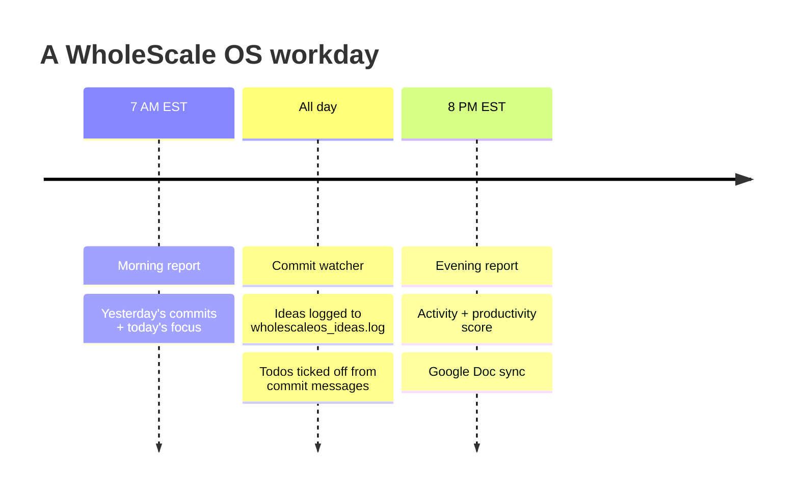
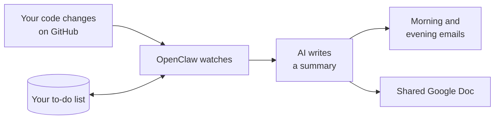
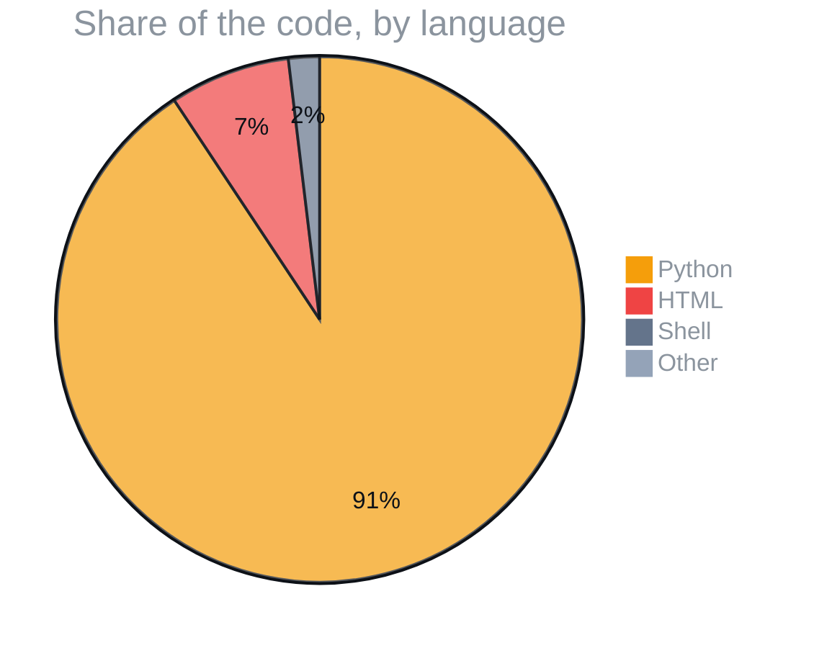

<p align="center">
  
</p>

<p align="center">
  
  
  
  
</p>
<p align="center">
  
  
  
  
  
</p>

<h3 align="center">A round-the-clock productivity system for WholeScale OS. It reads your commits, tracks your todo list and emails you a morning plan and an evening scorecard.</h3>

<p align="center">
  <a href="#️-a-day-with-openclaw">A day with OpenClaw</a> ·
  <a href="#-how-it-works">How it works</a> ·
  <a href="#-what-its-written-in">What it's written in</a> ·
  <a href="#-field-manual">Field manual</a> ·
  <a href="#-license">License</a>
</p>

<p align="center"></p>


> [!TIP]
> **🤖 Pasted this link into Claude or ChatGPT?** AI assistants: read [`docs/AI_GUIDE.md`](https://raw.githubusercontent.com/F0rger123/wholescaleos-openclaw/main/docs/AI_GUIDE.md) first. It explains what this is in plain words, which questions to ask, and how to set it up step by step. Plain-text index: [`llms.txt`](https://raw.githubusercontent.com/F0rger123/wholescaleos-openclaw/main/llms.txt).

## ☀️ A day with OpenClaw



## 🧠 How it works



Deployment guides: [`DEPLOYMENT.md`](DEPLOYMENT.md), [`setup_24_7_google_cloud.md`](setup_24_7_google_cloud.md) and [`GMAIL_SETUP.md`](GMAIL_SETUP.md).

## 📊 What it's written in



<p align="center"></p>

## 📚 Field manual

An automated system that monitors your GitHub commits and sends daily productivity reports via email.

## Features

- **Morning Report (7:00 AM EST)**: Yesterday's accomplishments + today's focus
- **Evening Report (8:00 PM EST)**: Today's activity + productivity score
- **AI-Powered Summaries**: Uses Gemini AI for natural language summaries
- **Todo Tracking**: Automatically tracks todo completion based on commits
- **Productivity Metrics**: Calculates scores and visual indicators
- **Mobile-Friendly Emails**: Clean, responsive email templates

## Quick Start

1. **Copy files** to your repository:
   ```
   .github/workflows/productivity-reports.yml
   scripts/
   templates/
   config/secrets.json.example
   requirements.txt
   ```

2. **Set up API keys** (all free tier):
   - GitHub Personal Access Token
   - Google Gemini API Key
   - Resend API Key (email service)

3. **Configure secrets** in GitHub repository settings

4. **Initialize your todo list** in `data/todo_list.json`

5. **Push to GitHub** - reports will start automatically!

## File Structure

```
.github/workflows/productivity-reports.yml  # GitHub Actions workflow
scripts/report_generator.py                 # Main report logic
scripts/todo_manager.py                     # Todo list management
scripts/run_report.py                       # Entry point
templates/morning_report.html              # Morning email template
templates/evening_report.html              # Evening email template
config/secrets.json.example                # Configuration template
data/todo_list.json                        # Your todo list
requirements.txt                           # Python dependencies
DEPLOYMENT.md                              # Detailed setup guide
```

## Sample Reports

### Morning Report Includes:
- Yesterday's commits with messages and file counts
- AI summary of accomplishments
- Todo progress (completed vs remaining)
- Recommended focus items for today

### Evening Report Includes:
- Today's commit activity
- Productivity score with visual indicator
- Todo completion percentage
- Preview of tomorrow's tasks
- High-priority overdue items

## Cost

**Completely free** using:
- GitHub Actions (free for public repos)
- Gemini API (free tier: 60 requests/minute)
- Resend (free tier: 100 emails/day)

## Customization

- Edit email templates in `templates/`
- Adjust schedule in `.github/workflows/productivity-reports.yml`
- Modify todo matching logic in `report_generator.py`
- Use different email provider (SMTP supported)

## Support

See [DEPLOYMENT.md](DEPLOYMENT.md) for detailed setup instructions and troubleshooting.

---

**Next Steps**: 
1. Provide your actual todo list
2. Follow the deployment guide
3. Test with dry-run mode
4. Enjoy automated productivity insights!

## 📜 License

Released under the [MIT License](LICENSE). Use it, fork it, ship it.

<p align="center"></p>

<p align="center">
  <sub>Built by <a href="https://github.com/F0rger123"><b>@F0rger123</b></a> · MIT licensed</sub>
</p>
